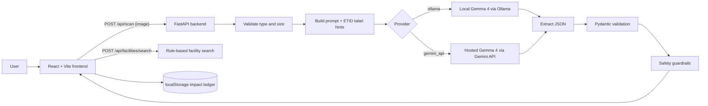

# EcoLens ♻️

**AI-assisted e-waste identification, safe reuse/repair guidance, and verified disposal routes, powered by Google Gemma 4.**

EcoLens helps people decide what to do with old electronics. Snap a photo, and a Gemma 4 model identifies the item, flags visible damage, and recommends whether to reuse, repair, or recycle it. Deterministic safety guardrails make sure the AI can never talk someone into reusing a dangerous device.

> Built for the **Gemma 4 hackathon** ("Best use of Gemma 4").

<!-- Add screenshots / demo GIF here -->
<!--  -->

---

## Table of contents

- [Features](#features)
- [How Gemma 4 is used](#how-gemma-4-is-used)
- [Architecture](#architecture)
- [Tech stack](#tech-stack)
- [Project structure](#project-structure)
- [Getting started](#getting-started)
- [Configuration](#configuration)
- [API reference](#api-reference)
- [Safety guardrails](#safety-guardrails)
- [Testing](#testing)
- [Evaluation on ETID](#evaluation-on-etid)
- [Design decisions](#design-decisions)
- [Limitations](#limitations)
- [Roadmap](#roadmap)
- [Contributing](#contributing)
- [License](#license)
- [Acknowledgements](#acknowledgements)

---

## Features

| Page | What it does | Uses AI? |
| --- | --- | --- |
| **Overview** | Dashboard with live AI status and a summary of your confirmed actions | No |
| **AI Scanner** | Upload or capture a photo; Gemma 4 returns item name, category, condition, damage clues, confidence, and a recommended handover | **Yes** |
| **Reuse & Repair** | Guidance for reuse, repair, or recycling, with deterministic safety overrides. Mark an item as reused, repaired, or recycled | No |
| **Disposal Finder** | Search verified collection points and recyclers by location and item category. Each entry cites its source and verification date | No (rule-based) |
| **My Impact** | Local ledger of confirmed actions, a personal goal tracker, and filterable history | No |

## How Gemma 4 is used

Gemma 4 powers the **AI Scanner**, where it acts as a vision-language model that turns a photo into structured JSON.

1. The image and a carefully constrained prompt are sent to Gemma 4.
2. The prompt includes the exact output schema, allowed enums, and rules such as *only describe what is visible* and *never output null*.
3. [ETID](#evaluation-on-etid) class names are passed as label hints so predictions can be scored against a public dataset.
4. The raw reply is parsed defensively (fences and stray prose are stripped) and validated with Pydantic.
5. A deterministic [guardrail layer](#safety-guardrails) post-processes the result before it reaches the user.

Two interchangeable providers are supported through a single function (`run_gemma_vision`):

| Provider | `GEMMA_PROVIDER` | Default model | Notes |
| --- | --- | --- | --- |
| Local (Ollama) | `ollama` | `gemma4:e4b` | Runs on your machine; images never leave your device |
| Hosted (Gemini API) | `gemini_api` | `gemma-4-26b-a4b-it` | Requires an API key |

Gemma 4 is deliberately **not** used for disposal facility lookup or safety decisions. Those need to be verifiable and predictable, so they are rule-based.

## Architecture



## Tech stack

**Backend:** Python, FastAPI, Uvicorn, Pydantic v2 / pydantic-settings, httpx, Pillow, `google-genai`, pytest

**Frontend:** React 19, Vite, Tailwind CSS v4, lucide-react

**Model:** Google Gemma 4 (local through Ollama, or hosted through the Gemini API)

**Dataset (evaluation):** E-Tadweer Image Dataset (ETID)

## Project structure

```
.
├── backend/
│   ├── app/
│   │   ├── main.py             # FastAPI app and routes
│   │   ├── config.py           # Settings (env-driven) and JSON loaders
│   │   ├── gemma_client.py     # Provider-agnostic Gemma 4 vision call
│   │   ├── prompts.py          # System prompt, user prompt, JSON extraction
│   │   ├── schemas.py          # Pydantic models and validators
│   │   ├── guardrails.py       # Deterministic safety overrides
│   │   ├── disposal.py         # Rule-based facility search
│   │   ├── facilities.json     # Verified facilities with sources
│   │   └── dataset_labels.json # ETID class → EcoLens category mapping
│   ├── scripts/
│   │   ├── make_eval_split.py  # Build a reproducible ETID eval split
│   │   └── evaluate_etid.py    # Run Gemma 4 on the split and report metrics
│   ├── tests/
│   └── requirements.txt
├── frontend/
│   ├── src/
│   │   ├── App.tsx             # Pages: Overview, Scanner, Repair, Finder, Impact
│   │   ├── lib/api.ts          # Backend client
│   │   └── lib/types.ts        # Shared TypeScript types
│   ├── index.html
│   └── package.json
├── vite.config.ts
└── .mise.toml                  # Node 22, pnpm
```

## Getting started

### Prerequisites

- Python 3.10+
- Node.js 22 and pnpm (`.mise.toml` pins the versions)
- **One** of: [Ollama](https://ollama.com) installed locally, **or** a Gemini API key

### 1. Clone

```bash
git clone https://github.com/Rhea-15/<repo-name>.git
cd <repo-name>
```

### 2. Backend

```bash
cd backend
python -m venv .venv
source .venv/bin/activate        # Windows: .venv\Scripts\activate
pip install -r requirements.txt
```

Create `backend/.env` (see [Configuration](#configuration)) and pick a provider:

**Option A: local Gemma 4 with Ollama (default)**

```bash
ollama pull gemma4:e4b
ollama serve                      # skip if Ollama is already running
```

```env
GEMMA_PROVIDER=ollama
OLLAMA_MODEL=gemma4:e4b
```

**Option B: hosted Gemma 4 with the Gemini API**

```env
GEMMA_PROVIDER=gemini_api
GEMMA_API_KEY=your_key_here
GEMMA_API_MODEL=gemma-4-26b-a4b-it
```

Start the API:

```bash
uvicorn app.main:app --reload --port 8000
```

Check it: <http://localhost:8000/api/health>. Interactive docs are at <http://localhost:8000/docs>.

### 3. Frontend

```bash
cd frontend
pnpm install
pnpm dev
```

By default the frontend calls `http://localhost:8000`. To change this, set `VITE_API_BASE_URL` in `frontend/.env`:

```env
VITE_API_BASE_URL=http://localhost:8000
```

> **CORS:** the backend allows `http://localhost:5173` by default. If your dev server runs on a different port, add it to `CORS_ORIGINS`.

### 4. Try it

1. Open the app and go to **AI Scanner**.
2. Upload a photo of a phone, cable, battery, keyboard, and so on.
3. Review the result, then continue to **Reuse & Repair** and mark an action.
4. Check **My Impact** to see it recorded.

## Configuration

All backend settings are environment variables (or entries in `backend/.env`).

| Variable | Default | Description |
| --- | --- | --- |
| `GEMMA_PROVIDER` | `ollama` | `ollama` or `gemini_api` |
| `OLLAMA_BASE_URL` | `http://localhost:11434` | Ollama server URL |
| `OLLAMA_MODEL` | `gemma4:e4b` | Ollama model tag |
| `GEMMA_API_KEY` | *(empty)* | Required when using `gemini_api` |
| `GEMMA_API_MODEL` | `gemma-4-26b-a4b-it` | Hosted model name |
| `CORS_ORIGINS` | `http://localhost:5173` | Comma-separated allowed origins |
| `MAX_UPLOAD_MB` | `10` | Maximum upload size |

Frontend: `VITE_API_BASE_URL` (default `http://localhost:8000`).

## API reference

### `GET /api/health`
Returns service status and the active provider.

```json
{ "status": "ok", "ai_status": "ready", "provider": "ollama" }
```

### `POST /api/scan`
`multipart/form-data` with a `file` field (JPEG, PNG, or WebP).

```bash
curl -X POST http://localhost:8000/api/scan -F "file=@phone.jpg"
```

Example response (illustrative):

```json
{
  "result": {
    "item_name": "Smartphone",
    "category": "phones",
    "condition": "needs_repair",
    "damage_clues": [{ "description": "Cracked screen", "severity": "medium" }],
    "confidence": 0.86,
    "uncertainty_note": "",
    "dataset_label": "Mobile",
    "recommended_handover": "repair",
    "handover_links": ["repair", "recycle"],
    "safety_warnings": []
  },
  "provider": "ollama",
  "model": "gemma4:e4b"
}
```

| Status | Meaning |
| --- | --- |
| 413 | Image larger than `MAX_UPLOAD_MB` |
| 415 | Unsupported image type |
| 502 | Model returned output that could not be parsed or validated |

### `POST /api/facilities/search`

```json
{ "location": "Mumbai", "category": "All items" }
```

Returns `{ "results": [ ...facilities ] }`. `location` matches name, address, city, or state. A specific `category` only returns facilities that list that item in `accepts`.

### `POST /api/impact/log`
Validates and echoes an action entry (`Reused`, `Repaired`, or `Recycled`). The current frontend stores the ledger locally in the browser.

## Safety guardrails

AI output is treated as a suggestion, not a verdict. After every scan, `apply_guardrails` checks the damage clues for hard-stop terms:

`swollen` · `bulging` · `exposed wire` · `exposed copper` · `burn` · `leak`

If any match, EcoLens:

- sets `condition` to `unsafe`
- forces `recommended_handover` to `recycle` and restricts handover links to recycling
- appends a fixed, human-written safety warning

An `unsafe` condition can never be downgraded by the model, so a hallucinated "this swollen battery is fine to reuse" cannot reach the user.

## Testing

From `backend/`:

```bash
pytest
```

Tests cover the API surface (health check, MIME validation, facility search), facility filtering, and the guardrail rules (forced recycling, no downgrade of unsafe items, clean items untouched). Tests don't call the model, so no Ollama or API key is needed.

## Evaluation on ETID

EcoLens is evaluated on the **E-Tadweer Image Dataset (ETID)**. `backend/app/dataset_labels.json` maps each ETID class to an EcoLens category:

| ETID class | EcoLens category |
| --- | --- |
| Battery | batteries |
| Cable | cables |
| Keyboard, Mouse | accessories |
| Laptop, PCB | computers |
| Mobile | phones |

**1. Build a reproducible held-out split** (40 random images per class, fixed seed):

```bash
cd backend
python scripts/make_eval_split.py \
  --source "/path/to/E-Tadweer Image Dataset (ETID)" \
  --dest data/etid_eval --per-class 40 --seed 42
```

**2. Run Gemma 4 on the split:**

```bash
python scripts/evaluate_etid.py --data data/etid_eval --out etid_results.json
```

The script prints a summary and writes full results to `etid_results.json`:

- `label_accuracy`: predicted `dataset_label` vs. the ground-truth class
- `category_accuracy`: predicted `category` vs. the mapped EcoLens category
- `json_parse_failures`: replies that could not be parsed as JSON
- per-class accuracy and a confusion matrix

### Results

<!-- Fill in after running the evaluation -->

| Model | Provider | Images | Label acc. | Category acc. | Parse failures |
| --- | --- | --- | --- | --- | --- |
| _TBD_ | _TBD_ | _TBD_ | _TBD_ | _TBD_ | _TBD_ |

## Design decisions

- **AI where it helps, rules where it matters.** Perception is probabilistic, so Gemma 4 handles it. Safety and disposal are deterministic and auditable.
- **Provider abstraction.** One function supports local and hosted Gemma 4, so the app runs offline with Ollama or on any machine with an API key.
- **Defensive structured output.** The schema is in the prompt, JSON is extracted tolerantly, and Pydantic validators coerce `null` values models tend to emit.
- **Low temperature (0.1)** for consistent, schema-faithful answers.
- **Sourced facility data.** Each facility records its source URL and verification date, and uncertain details (accepted items, public access) are flagged to confirm before visiting rather than guessed.
- **Honest uncertainty.** The model is asked for a `confidence` score and an `uncertainty_note` instead of forcing a confident answer on unclear images.

## Limitations

- Identification covers the categories in the schema and the ETID classes; unusual devices may fall into `other`.
- Damage detection depends on image quality and what is visible. It is not a substitute for professional inspection.
- Guardrail matching is keyword-based, so unusual phrasing may slip past it. Treat all battery and wiring warnings seriously regardless.
- The facility list is a small, manually verified seed set. Always confirm details with the facility before visiting.
- The impact ledger lives in browser `localStorage`, so it is per-device and cleared with site data.

## Contributing

Contributions are welcome.

1. Fork the repo and create a branch from `main`.
2. Make your change with tests where relevant (`pytest` in `backend/`).
3. Open a pull request with a concise description of what changed and why.

## License

<!-- Choose a license, e.g. MIT, and add a LICENSE file -->

## Acknowledgements

- [Google Gemma 4](https://ai.google.dev/gemma) for the multimodal model
- [Ollama](https://ollama.com) for local inference
- E-Tadweer Image Dataset (ETID) for evaluation data
- Facility information sourced from the public pages cited in `backend/app/facilities.json`